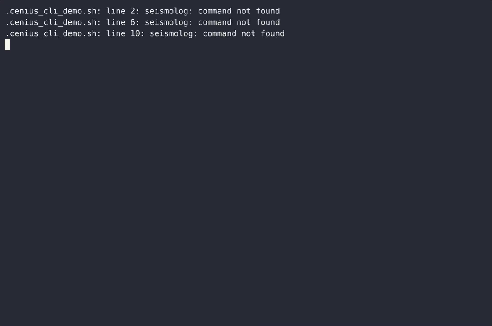
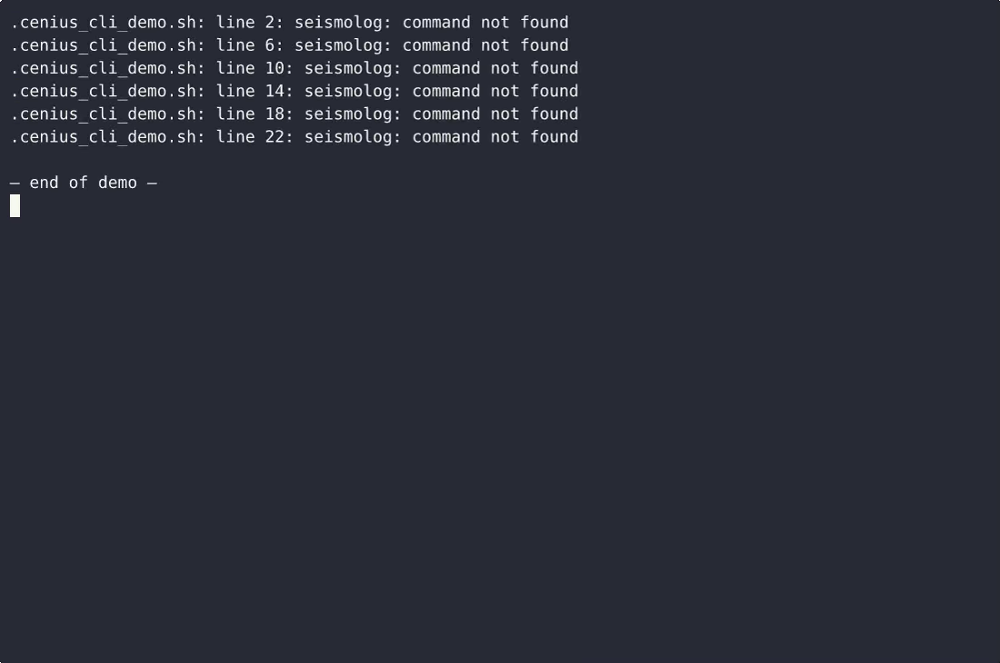

# Seismolog — complete Full-stack app command-line tool example app

**Seismolog** is a production-grade command-line tool written in Full-stack app — generated by cenius.ai, Apache-2.0-licensed. Seismolog is a single-file, standard-library-only Python command-line tool that records seismic events (magnitude, depth, time, place) into a local JSON store, reports the great-circle distance from any coordinate to…. Clone Seismolog, run the installer, done — you have a working product in minutes. Want to change something? [Open Seismolog on cenius.ai](https://cenius.ai/marketplace/p/seismolog?ref=gh&utm_campaign=seismolog-webapp) and say what you need — a revised build ships back, ready to deploy.


[](LICENSE)  [](https://cenius.ai)

[](https://cenius.ai/marketplace/p/seismolog?ref=gh&utm_campaign=seismolog-webapp)

> **▶ [Open & edit in cenius.ai](https://cenius.ai/marketplace/p/seismolog?ref=gh&utm_campaign=seismolog-webapp)** — one click to an editable workspace: describe changes in plain English, get an instant preview, one-click deploy and host. Modifications made on the platform come with full rebrand & relicense rights.

_Local clone? See [Quick start](#quick-start) below. cenius.ai is the zero-setup path._

## Demo


📽 **[Demo video on cenius.ai](https://cenius.ai/marketplace/p/seismolog?ref=gh&utm_campaign=seismolog-webapp)** — the complete run-through · [MP4](.github/media/demo.mp4)

## Screenshots

 

## Quick start

```bash
./install.sh   # installs dependencies + seeds demo data
```

See [`INSTALL.md`](INSTALL.md) for full setup and usage instructions.

## Usage guide

Every command below is copy-pasteable from the project root. `python3 seismolog.py`
can be shortened to `seismolog` once `install.sh` has run.

### 1. Record an event

```bash
python3 seismolog.py record -m 6.1 -d 14.5 -p "Hualien, Taiwan" --time 2024-04-02T23:58:00Z
```

```
Recorded event #3
────────────────────
  id:        3
  time:      2024-04-02T23:58:00Z
  magnitude: 6.1
  depth km:  14.5
  place:     Hualien, Taiwan
store: /home/you/.seismolog/events.jsonl
```

* `-m/--magnitude` is required, on the 0.0–10.0 scale.
* `-d/--depth` is required, in kilometres, and must not be negative.
* `-p/--place` is optional and stored verbatim; omitted, it becomes `unknown`.
* `--time` is optional ISO-8601. A bare date (`2024-04-02`), a `Z` stamp and an
  offset stamp (`2024-04-02T23:58:00+08:00`) are all accepted and normalised to UTC.
  Omitted, the event gets the current UTC time.
* The id is assigned at write time: one greater than the highest id already stored.

The echoed block always matches the line written to the store. Any validation
failure prints one line to stderr, writes nothing and exits `2`:

```bash
$ python3 seismolog.py record -m 12 -d 10
error: magnitude must be between 0 and 10 (got 12)
$ echo $?
2
```

#### Scripting it

```bash
python3 seismolog.py record --json -m 4.9 -d 8
{"stored": {"id": 4, "time": "2026-10-12T21:19:51Z", "magnitude": 4.9, "depth_km": 8.0, "place": "unknown"}, "store": "/home/you/.seismolog/events.jsonl"}
```

### 2. List what you have recorded

```bash
python3 seismolog.py list
```

_Full guide: [`USAGE.md`](USAGE.md)_

## Features

- Seismic event recording with magnitude and depth
- Tectonic plate boundary distance calculator
- Historical earthquake comparison chart

## Architecture

No external services required: the entire command-line tool runs from this Full-stack app repo (17 files). Top-level layout: `tests/`. Kick off `./install.sh` to pull packages and seed the database, then the app is up. See [`INSTALL.md`](INSTALL.md) for complete setup instructions.

## FAQ

### How do I run Seismolog on my own server?

Everything you need ships in this repo: clone it, run `./install.sh` to install dependencies and seed demo data, then follow [`INSTALL.md`](INSTALL.md) to start it. No external services required.

### Can non-developers customise Seismolog?

The easiest route: [visit the project on cenius.ai](https://cenius.ai/marketplace/p/seismolog?ref=gh&utm_campaign=seismolog-webapp), tell the platform what to change, and collect the updated build. No source-editing needed.

### Can I remove the Seismolog name and use my own?

Yes — and the easiest way is [remixing it on cenius.ai](https://cenius.ai/marketplace/p/seismolog?ref=gh&utm_campaign=seismolog-webapp): modifications made on the platform come with full rebrand and relicense rights over your derivative.

### How is Seismolog built technically?

Seismolog runs on Full-stack app. This repo holds the full production source: you can inspect every part of it before deploying. Highlights include seismic event recording with magnitude and depth.

### Can I use Seismolog in a commercial project?

Yes — it ships under the Apache-2.0 license, which permits commercial use, modification and redistribution. The full text is in [LICENSE](LICENSE).

## License & rebranding

Released under the [Apache License 2.0](LICENSE) (© 2026 Cenius AI) — free for personal and commercial use. The Cenius name/logo are trademarks (see NOTICE).

**Need a customized version?** [Remix this app on cenius.ai](https://cenius.ai/marketplace/p/seismolog?ref=gh&utm_campaign=seismolog-webapp) — modifications made on the platform come with **full rebrand & relicense rights** over your derivative.

## Built with cenius.ai

This entire application — code, design, seeded demo data — was generated on **[cenius.ai](https://cenius.ai)** from a plain-English description.

- 🚀 [Build your own app on cenius.ai](https://cenius.ai)
- 🎛️ [Remix Seismolog on the marketplace](https://cenius.ai/marketplace/p/seismolog?ref=gh&utm_campaign=seismolog-webapp) — open it in a workspace, prompt for changes, and ship your own version.

More open-source apps: [the Cenius-ai catalog](https://github.com/Cenius-ai) · [showcase index](https://github.com/Cenius-ai/showcase)
